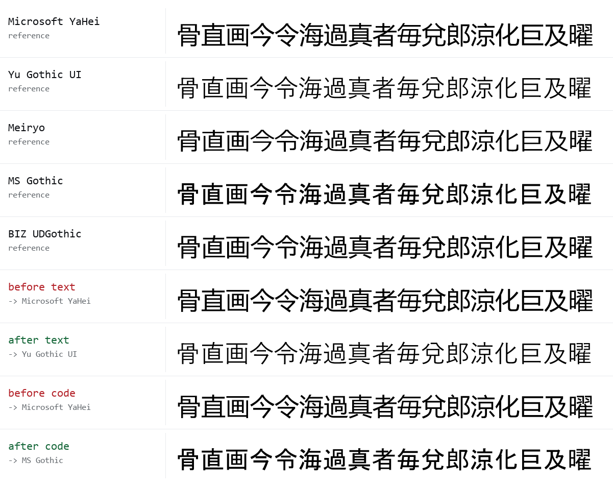

# dsh-jp-fonts

dsh（DeepSeek Harness）の UI が漢字を**中華フォントの字形**で描く問題を、アプリを書き換えずに直すための道具と記録。



上の 5 行が各フォント単体の参照、下 4 行が dsh の実際のスタック。組み込みスタックは Microsoft YaHei と、修正後は Yu Gothic UI / MS Gothic と画素単位で一致している（1 行目と 6 行目、2 行目と 7 行目を見比べるとよい）。

## 症状

日本語環境の Windows で dsh を開くと、漢字が簡体字の字形で表示される。

- `骨` `直` `画` `今` `令` `海` `者` `毎` `兌` などが、日本語として違和感のある形になる
- コードブロックやインラインコード中の日本語も同じ
- フォントを変えた覚えはないのに、中国語のアプリを開いたときのような字面になる

## 原因

dsh の組み込みフォントスタックに、**日本語ファミリが 1 つも入っていない**（`@deepseek-ai/dsh-client-ui-theme` の `src/styles/base.css`。配布物では `lib/client.js` に CSS ごとインライン化されている）。

```css
--dsh-font-family-text-default:
  -apple-system, BlinkMacSystemFont, "Segoe UI",
  "PingFang SC", "Hiragino Sans GB", "Microsoft YaHei",
  "Helvetica Neue", Helvetica, Arial, sans-serif;

--dsh-font-family-code-default:
  "SF Mono", "JetBrains Mono", "Fira Code", Consolas,
  "Liberation Mono", Menlo, Courier, "PingFang SC", "Microsoft YaHei";
```

CJK の候補は PingFang SC（macOS）→ Hiragino Sans GB（macOS）→ **Microsoft YaHei** の 3 つだけで、どれも中国語フォント。Windows には PingFang SC も Hiragino Sans GB も無いので、YaHei が入っていれば必ずそこに落ちる。YaHei は Office などと一緒に入ることが多く、日本語版 Windows でも珍しくない（検証に使った環境にも入っていた）。

ブラウザのフォント選択は**文字ごと**にリストを先頭から見るので、`Segoe UI`（CJK を持たない）を通過した漢字は YaHei で描かれる。`Consolas` も同じ理由で、コード中の日本語が YaHei になる。

ターミナルだけは別経路で `ui-monospace, SFMono-Regular, Menlo, Consolas, monospace`（`dsh-client-ui-sidebar-terminal`）なので、`monospace` の既定＝日本語フォントに落ちて助かっている。ただし既定次第なので明示したほうがよい。

## 実測

推測ではなく、実際の Chromium（Edge ヘッドレス）に描かせて画素で照合した。方法は [`verify/`](verify/)。

| スタック | 描画に使われたフォント | 参照との差 |
| --- | --- | --- |
| 組み込み text | Microsoft YaHei | **0.0%**（次点 BIZ UDGothic 34.1%） |
| text + `Yu Gothic UI` | Yu Gothic UI | **0.0%**（次点 MS Gothic 29.9%） |
| 組み込み code | Microsoft YaHei | **0.0%**（次点 BIZ UDGothic 34.1%） |
| code + `MS Gothic` | MS Gothic | **0.0%**（次点 Yu Gothic UI 29.9%） |

字形の差は「雰囲気」ではなく、レンダリング結果が別フォントと完全一致／完全不一致で出る。差は 0% か 30% 以上かに二分される。

## 直し方

### 1. 設定画面（いちばん簡単・即時反映）

設定 → General → **Text font** / **Code font** / **Terminal font** に値を入れる。空欄なら組み込みスタックに戻る。入力したリストは組み込みスタックの**前**に置かれるので、書かなかった書体は今までどおり使われる。

Windows の日本語環境なら:

| 項目 | 値 |
| --- | --- |
| Text font | `Segoe UI, Yu Gothic UI` |
| Code font | `Consolas, MS Gothic` |
| Terminal font | `Consolas, MS Gothic` |

### 2. プロファイル patch に書く（再起動で反映）

`~/.dsh/profiles/<profile>/cordis.patch.yml`（設定画面が保存するのと同じ場所）に追記する。

```yaml
- id: ui-theme
  name: "@deepseek-ai/dsh-client-ui-theme"
  config:
    textFontFamily: 'Segoe UI, Yu Gothic UI'
    codeFontFamily: 'Consolas, MS Gothic'
    terminalFontFamily: 'Consolas, MS Gothic'
```

patch は起動時に読まれるので、**dsh の再起動が必要**。設定画面から入れた場合は即時反映される（同じ patch に書かれる）。

### 3. このリポジトリのスクリプト

Node 18 以上、依存パッケージなし。

```console
$ node dsh-jp-fonts.mjs check
profile  desktop
text     Segoe UI, Yu Gothic UI
         "Segoe UI", "Yu Gothic UI", -apple-system, BlinkMacSystemFont, "Segoe UI", …
         -> Yu Gothic UI (Japanese shapes)

$ node dsh-jp-fonts.mjs apply      # 書き込む（バックアップ自動作成・冪等）
$ node dsh-jp-fonts.mjs revert     # 元に戻す
$ node dsh-jp-fonts.mjs apply --dry-run --text 'Meiryo, Noto Sans JP'
```

- `check` は「どのファミリが漢字を拾うか」を判定し、中国語フォントに解決する役割があれば終了コード 1 を返す（CI や起動時チェックに使える）
- 書き換えるのは 3 つのキーだけで、コメントや他の設定（`preference: dark` など）はそのまま残る
- 書き込み前に `cordis.patch.yml.bak-<timestamp>` を作る
- `--profile` / `--home` で対象を指定（既定は `desktop` と `$DSH_HOME`、無ければ `~/.dsh`）

## 推奨値

OS ごとの既定（スクリプトが自動で選ぶ値）。

| OS | Text | Code | Terminal |
| --- | --- | --- | --- |
| Windows | `Segoe UI, Yu Gothic UI` | `Consolas, MS Gothic` | `Consolas, MS Gothic` |
| macOS | `-apple-system, Hiragino Sans` | `SF Mono, Hiragino Sans` | `SF Mono, Hiragino Sans` |
| Linux | `Noto Sans JP, Noto Sans CJK JP` | `JetBrains Mono, Noto Sans Mono CJK JP` | `JetBrains Mono, Noto Sans Mono CJK JP` |

書体の好みで差し替えてよい。候補:

- 本文: `Yu Gothic UI`（Windows 10/11 の日本語 UI 標準）, `Meiryo`, `BIZ UDGothic`, `Noto Sans JP`
- コード/ターミナル: `MS Gothic`（等幅・古典）, `BIZ UDGothic`（等幅・現代的）, `Noto Sans Mono CJK JP`

Latin を先に書くのがコツ。`Segoe UI, Yu Gothic UI` なら英数字は Segoe UI、漢字だけ Yu Gothic UI になる。逆順にすると英数字まで日本語フォントの字形になる。

## 検証

[`verify/`](verify/) に、ヘッドレスブラウザで描かせてフォントを同定する道具を置いてある。手順は [`verify/README.md`](verify/README.md)。

```console
$ msedge --headless=new --force-device-scale-factor=3 --screenshot=ref.png \
    --window-size=820,580 verify/references.html
$ python verify/identify-fonts.py ref.png
```

## 既知の限界

この設定は `--dsw-font-family` / `--ds-font-family-code` を通る箇所にしか効かない。app.asar の中でフォントを直書きしている箇所は残る。

| 箇所 | スタック |
| --- | --- |
| アップデートダイアログ `renderer/update-dialog.css` | `-apple-system, BlinkMacSystemFont, "Segoe UI", "Microsoft YaHei", sans-serif` |
| 軌跡ビューのツール名 `dsh-client-ui-trajectory` | `Menlo, Consolas, …, "PingFang SC", "Microsoft YaHei"` |
| ドキュメントプレビュー（Excel）`dsh-client-ui-sidebar-documentpreview` | `Helvetica Neue, …, "Microsoft YaHei", …` |

ツール名はほぼ ASCII なので実害は小さい。根本的に直すなら本体側で**ロケール連動**にするのが筋（`ja` のときは日本語ファミリを YaHei より前に置く）。このプロファイル設定はその場しのぎだが、アプリを更新しても消えないという利点はある。

## bundle として配る（未検証）

dsh のプラグイン機構に載せると、`dsh plugin add` 一発で入る。bundle は `dsh.profile.bundles` の末尾に足され、その patch 層は組み込みより後・ユーザー patch より前に積まれる。

`package.json`:

```json
{
  "name": "dsh-jp-fonts",
  "version": "0.1.0",
  "dsh": { "bundle": { "patch": ["./cordis.patch.yml"] } }
}
```

`cordis.patch.yml` は上のスニペットと同じ。`dsh plugin --profile <name> add <spec>` で入るはずだが、**このリポジトリでは試していない**（desktop プロファイルはアプリが管理していて CLI から触れないため）。GUI の 設定 → Plugins から入れる経路も未確認。

## License

MIT
